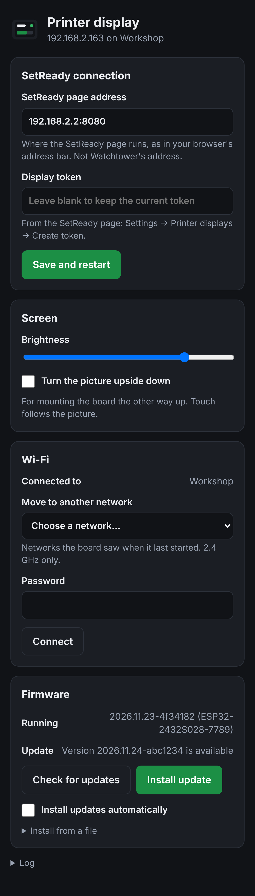

#  MakeReady

Gets each printer in a [Watchtower](https://watchtower3d.com) 3D-printer farm **ready
for its next job**, so Watchtower can send it one.

"Makeready" is the commercial printers' word for everything done to a press between one
job and the next. (This project was called Watchtower-SetReady until November 2026. The old
repository address redirects here; the Docker image is now only published as
`makeready`.)

Watchtower runs the queue: it decides which job goes to which printer and sends it.
It can only do that once a printer has been cleared and marked ready, and has the
filament the job needs. That is the part done by a person at the machine, and the part
this project is for. It tells you, printer by printer:

- when the plate needs clearing, with a **Set Ready** button to press once it is clear
  (and **Not ready** to take that back);
- which filament to load so a waiting job can run there;
- whether the spool has enough left for the job Set Ready would pick up.

It doesn't queue, slice or dispatch anything itself.

It started as virtual Set Ready buttons, doing the job of the
[ClearCue](https://github.com/ThePrintBench/ClearCue) hardware buttons without buying or
building any. Open it on a phone, a tablet or a wall-mounted display.

For each printer it shows:

- its state, progress, time left and finish time;
- a **Set Ready** button when the plate is waiting to be cleared, and **Not ready** to
  take it back;
- when Watchtower is sending it a job, with progress;
- **pause**, **stop** and **resume** buttons, each with a confirmation;
- a camera snapshot (optional);
- the filament loaded in its slots (optional).

Under the printers, a **Waiting jobs** list (optional) shows what each queued job needs
and which printer could run it, or what would have to be loaded where.

It can also drive a small **touch screen on the front of each printer**, showing that
printer's progress and what to load next, with its own Set Ready button. The page lists
the displays, shows which are connected and updates their firmware. See
[Printer displays](#printer-displays).


*Mock-up with sample data.*

It is one small Python server and one HTML page, with no dependencies. Not affiliated
with or endorsed by Watchtower.

## Contents

- [Quick start](#quick-start)
- [Settings](#settings)
- [Using the page](#using-the-page)
- [Printer displays](#printer-displays)
- [Running it permanently](#running-it-permanently)
- [Security](#security)
- [How it works](#how-it-works)
- [Limitations](#limitations)
- [Licence](#licence)

## Quick start

Needs Python 3.8 or later and nothing else: no packages to install. It runs the same on
Linux, macOS and Windows. To keep it running, as a service or in Docker, see
[below](#running-it-permanently).

1. In Watchtower, create an API key (starts with `wt_`) with the `control` scope,
   allowed to send `set_ready` and, for the other buttons, `resume`, `pause` and `cancel`.
2. Run `python3 server.py` and open `http://localhost:8080`.
3. The **Settings** dialog opens on first use. Enter the Watchtower address and the API
   key, then **Save**.

To use the page from other devices, start it with `HOST=0.0.0.0` and
[set a page password](#page-password).

## Settings

Everything is set from the **Settings** button in the page header and saved to
`config.json` next to `server.py` (or in `/config` in the Docker image). Secrets are
never sent back to the browser once saved.

### Watchtower connection

- **Watchtower address:** the IP address or name of the Watchtower computer, e.g.
  `192.168.1.50`. `https://` and `/api/public/v1` are added for you; type `http://…` or
  a `:port` if yours needs one.
- **API key:** the key from step 1. It has to be re-entered whenever the address
  changes, so a saved key can't be redirected to another machine.
- **Skip the certificate check:** tick this for `https://` unless you have set
  `WATCHTOWER_CA` (see [Other options](#other-options)). Watchtower signs its
  certificate with its own local CA, which Python doesn't trust by default.

### Cameras and queue (optional)

Camera pictures, the waiting-jobs list and loaded filament aren't part of Watchtower's
public API, so the API key can't fetch them. Enter a **Watchtower username and
password** and the server logs in to Watchtower's own web interface for them. Leave the
username blank to do without.

Two consequences of using that login:

- The password is stored in `config.json`, and it grants much more than the API key
  does. Use a dedicated Watchtower user with as few rights as possible if you can.
- That interface is undocumented and can change with a Watchtower update. If it does,
  pictures and the queue stop; the buttons keep working.

### Page password

Without a password, **anyone who can open the page can press the buttons, stop prints
and change the settings.** To lock it, enter a **Page password** of at least 8
characters. From then on every device has to log in once before it can see or do
anything; it stays logged in for a year, across restarts and updates.

- Changing the password logs out every other device.
- **Remove the password** opens the page up again; **Log out** logs out just this device.
- Five wrong passwords from one address block further tries from it for a minute.
- The password is stored as a salted hash, never in plain text.
- Forgotten it? Set `PAGE_PASSWORD_HASH` to `""` in `config.json` and restart.

### Other options

These go in `config.json` (see `config.example.json`) or in environment variables of the
same name. Environment variables win.

| Option | Purpose |
|---|---|
| `HOST` | `127.0.0.1` (default) serves the page only on this computer; `0.0.0.0` makes it reachable from the network |
| `PORT` | Port to listen on, default `8080` |
| `WATCHTOWER_CA` | Path to Watchtower's CA certificate (PEM), to verify `https://` properly instead of skipping the check |
| `PAGE_PASSWORD` | The page password, in plain text; takes precedence over one set in Settings |
| `CONFIG_DIR` | Folder holding `config.json` (environment only) |
| `REREAD_GAP` | Seconds to wait between AMS slots when re-reading tags, default `15` (environment only) |
| `WATCHTOWER_URL`, `WATCHTOWER_API_KEY`, `WATCHTOWER_USERNAME`, `WATCHTOWER_PASSWORD` | The same values as the Settings dialog |

## Using the page

### Printer cards

| Card | Meaning | Buttons |
|---|---|---|
| Green | Ready for the next job | **Not ready**: takes a Set Ready back, until a job is sent (needs the Watchtower login) |
| Red dot, solid green button | Plate waiting to be cleared | **Plate cleared – Set Ready**: press once the plate is clear |
| Red, slow pulse | Printing: time left and finish time in large type, and a bar that fills with the progress | Small **pause** and **stop** buttons |
| Red, fast blink | Paused or error, with time left | **Resume print** and a small **stop** button |
| Amber | Watchtower reports the printer offline | None |

Confirmations, so a stray touch on a wall tablet can't move a machine or lose a print:

- **Pause** and **Stop** open a dialog first. Stop cancels the job; it can't be resumed.
- **Resume** needs a second tap within 4 seconds.
- **Set Ready** is a single tap. **Not ready** undoes it if it was pressed by mistake.

If Watchtower refuses a command, the reason appears under the button.

The page refreshes every 5 seconds. The browser tab title shows how many plates are
waiting, e.g. `(2) MakeReady`.

### Cameras

With the Watchtower login set, each card shows a snapshot that refreshes every 5 seconds
(a still image, not live video). A camera named "chamber" is preferred when a printer
has several; printers with no online camera show no picture.

### Loaded filament and waiting jobs

With the Watchtower login set:

- **On each card:** a row of colour swatches for the filament loaded in its slots. Hover
  or tap a swatch for the name, type, grams left and slot. While the printer isn't
  printing, a small button beside the swatches asks the printer to **re-read the tags**
  of the AMS slots Watchtower shows as empty, for when you have put a spool in during a
  print and it hasn't been picked up. Each slot takes several seconds, and the swatches
  update as it is read. Slots that already have a reading are left alone. Only Bambu
  spools with a tag can be read this way. Below it, advice
  about the queue:
  - *Idle printer* (plate waiting, or ready): either **Set Ready can pick up a waiting
    job**, naming the job highest in Watchtower's queue that its loaded filament can
    run, or **No waiting job can run here yet**, with the job highest in the queue and
    exactly what to load for it. Reorder the queue in Watchtower and the advice follows.
    If the job needs more of a filament than is left on the loaded spool, the card says
    **Not enough filament loaded**, and pressing Set Ready asks first; you can carry on
    anyway.
  - *Busy printer:* a red **Load for waiting jobs** list, only when a job can't run
    anywhere and this printer is the closest fit.
- **Under the cards:** the **Waiting jobs** list. Each job shows the filaments it needs
  and the weight of each, e.g. "Gold PLA Basic (15g)", with missing ones outlined in
  red, and a verdict:
  - which printers can run it now;
  - its assigned printer has everything, or is missing something;
  - no printer has everything, with the closest printer and what to load into it.

Jobs with everything loaded have a green edge, the others a red one. **Hide jobs with
filament loaded** leaves only the ones that need attention; the choice is remembered per
device.

Colours are shown as swatches with a name. The name comes from, in order: a matching
spool loaded on the farm, a matching spool in Watchtower's inventory, Bambu Lab's colour
chart, or failing those a plain description such as "Orange" or "Dark grey".

The matching is this page's own estimate, not Watchtower's scheduler:

- material must match, and variant (Basic, Matte) when both are known;
- colour must be the same for jobs in "exact" mode, and close for jobs in "closest" mode;
- only printers of the job's model are considered;
- empty slots count as nothing loaded;
- grams left is an estimate: the printer's reported percentage of the spool's full
  weight. It is used for the low-filament warning, not for matching.

Watchtower makes the final decision, so treat "load X into Y" as a guide.

### Layout

The cards arrange themselves from the screen size and the number of printers:

- rows are evened out, so no printer sits alone on a row;
- when every printer fits without scrolling, the cards grow to fill the screen, which
  suits a wall display;
- on smaller screens the cards keep a readable size and the page scrolls;
- phones get one column.

Light and dark themes follow the device setting.

### On a phone or tablet's home screen

Add the page to the home screen to open it like an app, full screen, with its own icon:
in Safari use **Share → Add to Home Screen**; in Chrome use the menu's **Add to Home
screen** (or **Install app**). Handy for a tablet on the wall.

## Printer displays

A small touch screen for the front of each printer, one per printer, so whoever is
standing at the machine can see what it needs without opening the page.


*Mock-up of the screens with sample data.*

### What it shows

- **While printing:** estimated time left and estimated completion time in large type,
  and a bar that fills as the print goes on.
- **When paused:** the time left, still large, and a **Resume print** button.
- **When the print is done:** either **Set Ready picks up:** with the next job, or
  **Load for next job:** with the filament to fetch, by colour name and weight. A warning
  appears if a loaded spool has less than the job needs.
- **Set Ready:** a button on the screen, held for a second so a brush against it does
  nothing. Once the printer is ready the same button becomes **Not ready**, to take it
  back until a job is sent.
- **Receiving a job:** the job's name and a bar that fills as Watchtower sends it.
- **A job list:** swipe sideways, or tap the top bar, for the waiting jobs that could
  come to that printer, in Watchtower's order, each marked queued, assigned here or
  soft-assigned to another printer. Tap a job to see the filaments it needs and which
  of them this printer has loaded.
- **Dimming:** half brightness after five minutes without a touch; a touch brings it
  back.

### The hardware

| | |
|---|---|
| Board | ESP32-2432S028, sold as the "Cheap Yellow Display": an ESP32 with a 2.8" 320×240 colour touch screen on one board |
| Cost | Roughly £10–15 each |
| Power | USB, about 0.6–0.75 W (120–150 mA at 5 V); any USB port or phone charger. Can be powered from the USB port on a Bambu printer's AP board |
| Network | Wi-Fi, 2.4 GHz only |
| Screen types | Three look-alike variants (ILI9341, ST7789, ILI9342). There is a firmware file for each; boards with both a micro-USB and a USB-C socket have so far needed the ST7789 one. The orange LCDWiki 2.8inch ESP32-32E board (E32R28T) also works, with the ILI9341 file |

The same boards are often sold pre-loaded as desktop crypto "lottery miner" gadgets;
those work too, once reflashed.

### Setting one up

No software to install and nothing to edit; every board runs the same firmware.

1. **Flash it once** from a browser: download the firmware from the
   [display-latest release](https://github.com/M4-Consulting-Ltd/MakeReady/releases/tag/display-latest)
   and install it with <https://web.esphome.io> over USB.
2. **Scan the QR code** on the screen with a phone to join the board's own Wi-Fi, and
   choose your network.
3. **Create a token** for the printer under **Settings → Printer displays** on the
   MakeReady page.
4. **Scan the second QR code** to open the board's settings page, enter the MakeReady
   address and the token, and press **Save and restart**.

Each board has its own settings page on your network, where you can also:

- move it to another Wi-Fi network, picked from a list of those nearby;
- give it a name you will recognise on your network;
- see which firmware version it is running;
- check for a newer version, and install it over Wi-Fi, by hand or automatically;
- upload a firmware file directly;
- turn the picture upside down, for mounting either way round;
- dim the screen.



*Mock-up of a board's settings page.*

Full instructions, troubleshooting and how to build the firmware yourself are in
[display/README.md](display/README.md).

### Keeping track of many displays

**Settings → Printer displays** lists every display with a token: whether it is
connected (each one calls the server every 10 seconds), when it was last seen, its name
and address (a link to its own settings page), and its firmware version. When a newer
firmware is published the row says so, with an **Update** button; **Update all** does
every outdated display, three at a time so the whole farm isn't dark at once. The server
doesn't send the firmware: it asks the display, in its next reply, to fetch and install
the latest version itself, so displays still need to reach github.com.

Displays on firmware from before this feature show as connected, without a version, and
have to be updated once from their own page (or by themselves, if automatic updates are
on). The list is kept in memory, so it starts empty when the server restarts and fills
again within seconds.

### Settings for all displays

Under the list, **Settings for all displays** holds the choices every display shares.
They are sent to each display with its next update, so a change reaches the whole farm
within about 10 seconds, and they are kept in `config.json`.

- **Dim the screens after 5 minutes without a touch**, and how far: a percentage of the
  brightness set on each display's own page (5 to 90). Untick it to keep the screens at
  full brightness.
- **MakeReady address the displays call.** For when this server moves to another
  address: enter the new one and press **Send to displays**, and every connected display
  switches to it, so nobody has to visit each board. The server first checks that it can
  reach itself at that address and asks before sending one it can't confirm. A display
  that gets no answer at the new address within 45 seconds goes back to the one it had.
  Do this while the server still answers at the old address, since that is how the
  displays hear about the new one.

### What a display can do

Each token is tied to one printer. With it, a board can read that printer's summary and
send Set Ready for it or take it back, resume a paused print, and nothing else: no other printers, no cameras, no settings, no
pause or stop. Tokens are stored hashed and can be revoked in Settings. The board's own
settings page has no login, so anyone on your Wi-Fi can change a board's server address,
token or firmware.

### Status

Running on real boards: two-socket ESP32-2432S028 boards with the ST7789 screen, and an
LCDWiki ESP32-32E board with the ILI9341 screen. Flashing, on-screen setup, the printer
screens, live data and the "receiving a job" bar all work, the boards have been updated
over Wi-Fi, and touch works on the ESP32-32E board. Built but not yet confirmed one by
one on hardware: Not ready, Resume, dimming, renaming a board, and updating displays
from the MakeReady page.

## Running it permanently

Either way works; pick whichever suits the machine. Both keep their settings in one
`config.json`.

### Without Docker

Copy `server.py` and `index.html` to a folder on any always-on machine with Python 3.8
or later, and start `server.py` when the machine starts. On Linux with systemd, save
this as `/etc/systemd/system/makeready.service` (adjust the folder and user):

```ini
[Unit]
Description=MakeReady
After=network-online.target
Wants=network-online.target

[Service]
WorkingDirectory=/opt/makeready
ExecStart=/usr/bin/python3 /opt/makeready/server.py
Environment=HOST=0.0.0.0
Environment=PORT=8080
User=makeready
Restart=on-failure

[Install]
WantedBy=multi-user.target
```

Then `sudo systemctl enable --now makeready`. The user needs to be able to
write to the folder, since `config.json` is saved there (or set `CONFIG_DIR` to another
folder). To update, replace the two files and `sudo systemctl restart makeready`.

On Windows, run `python server.py` from Task Scheduler with the trigger "At startup";
on macOS, from a launchd agent.

### Docker

The image listens on port 8080 and keeps `config.json` in `/config`.

```bash
docker run -d --name makeready --restart unless-stopped \
  -p 8090:8080 -v /path/to/settings:/config \
  ghcr.io/m4-consulting-ltd/makeready:latest
```

Or with Docker Compose:

```yaml
services:
  makeready:
    image: ghcr.io/m4-consulting-ltd/makeready:latest
    restart: unless-stopped
    ports:
      - "8090:8080"
    volumes:
      - ./settings:/config
```

The page is then at `http://<host>:8090`. Open it, fill in Settings and set a page
password. To update, pull the new image and recreate the container
(`docker compose pull && docker compose up -d`); settings are kept, since they live in
the mounted folder.

The image is built and pushed to GitHub's container registry by
`.github/workflows/docker.yml` on every change to `main`. To build it yourself instead,
run `docker build -t makeready .` in this folder.

## Security

- **Set a page password** before making the page reachable from the network. Without
  one the page is open to anyone who can reach it.
- **Plain HTTP:** the page password and session travel unencrypted on your network. That
  is fine on a trusted home or workshop network. Do not expose the page to the internet;
  for outside access use a VPN or a reverse proxy that adds HTTPS.
- **Secrets stay on the server:** the API key and Watchtower password are held in
  `config.json` (written readable only by its owner) and never sent to the browser.
- **Limited commands:** the server forwards only `set_ready`, `resume`, `pause` and
  `cancel`, and only to the Watchtower address in Settings.
- **Other websites can't drive it:** cross-origin requests are refused and the page
  can't be embedded in a frame.

## How it works

`server.py` serves `index.html` and forwards a fixed list of calls to Watchtower. The
page talks to this small server rather than straight to Watchtower so the API key never
reaches the browser, and so the browser doesn't have to trust Watchtower's certificate
or be allowed by its cross-origin rules.

Public API, using the API key:

| Page calls | Watchtower call |
|---|---|
| `GET /api/printers` | `GET {base}/printers` |
| `POST /api/printers/{name}/set-ready` | `POST {base}/printers/{name}/commands` with `{"command":"set_ready"}` |
| `POST /api/printers/{name}/resume` | the same call with `{"command":"resume"}` |
| `POST /api/printers/{name}/pause` | the same call with `{"command":"pause"}` |
| `POST /api/printers/{name}/stop` | the same call with `{"command":"cancel","confirm":true}` |

Private web API, using the Watchtower login:

| Page calls | Watchtower call |
|---|---|
| `GET /api/cameras`, `GET /api/camera/{name}` | `GET /api/system/streams`, `GET /api/go2rtc/frame.jpeg?src=…` |
| `GET /api/queue` | `GET /api/queue`, `GET /api/filament/assignments`, `GET /api/printers` |
| `POST /api/printers/{name}/reread-filament` | Socket.IO event `printer_command` with `{"command":"read_slot_rfid","args":{"ams_index","tray_index"}}`, once per AMS slot |
| `POST /api/printers/{name}/not-ready` | Socket.IO event `printer_set_ready` with `{"printer_name","ready":false}`, the way Watchtower's own page does it |

The server's own calls: `GET`/`POST /api/config` (settings), `GET /api/session`,
`POST /api/login` and `POST /api/logout` (page password), `GET`/`POST /api/displays`
(display tokens), and for the displays themselves `GET /api/display` and
`POST /api/display/set-ready`, `POST /api/display/not-ready` and `POST /api/display/resume`, authorised by a display token.

The state rules come from ClearCue: offline when `online` is false; printing when
`busy` (paused or error if a status string says so); ready when `ready`; otherwise the
plate is waiting and the Set Ready button is live.

## Limitations

- **Unofficial API use:** Watchtower's API documentation wasn't available when this was
  written. The printer list, the `pause`, `resume` and `cancel` commands and everything
  on the private web API were worked out from ClearCue, a third-party client and real
  responses from one Watchtower install. Another Watchtower version may differ.
- **Paused or error:** the page can't tell the two apart, so **Resume print** also shows
  on a printer in an error state, where Watchtower is expected to reject it.
- **Filament matching is an estimate**, as described
  [above](#loaded-filament-and-waiting-jobs).
- **Jobs being sent** are read from a part of Watchtower's queue reply that has only
  been seen on one install; the job's name may be missing.
- **Not ready** uses the message Watchtower's own page sends, not a documented command.
- **Snapshots, not video.**

## Licence

Copyright (C) 2026 M4 Consulting Ltd.

This program is free software: you can redistribute it and/or modify it under the terms
of the GNU General Public License, version 3, as published by the Free Software
Foundation. It is distributed in the hope that it will be useful, but WITHOUT ANY
WARRANTY; without even the implied warranty of MERCHANTABILITY or FITNESS FOR A
PARTICULAR PURPOSE. See [LICENSE](LICENSE) for the full text.

The printer-state rules and the `set_ready` call are derived from
[ClearCue](https://github.com/ThePrintBench/ClearCue), which is distributed under the
GPLv3; this project uses the same licence.
