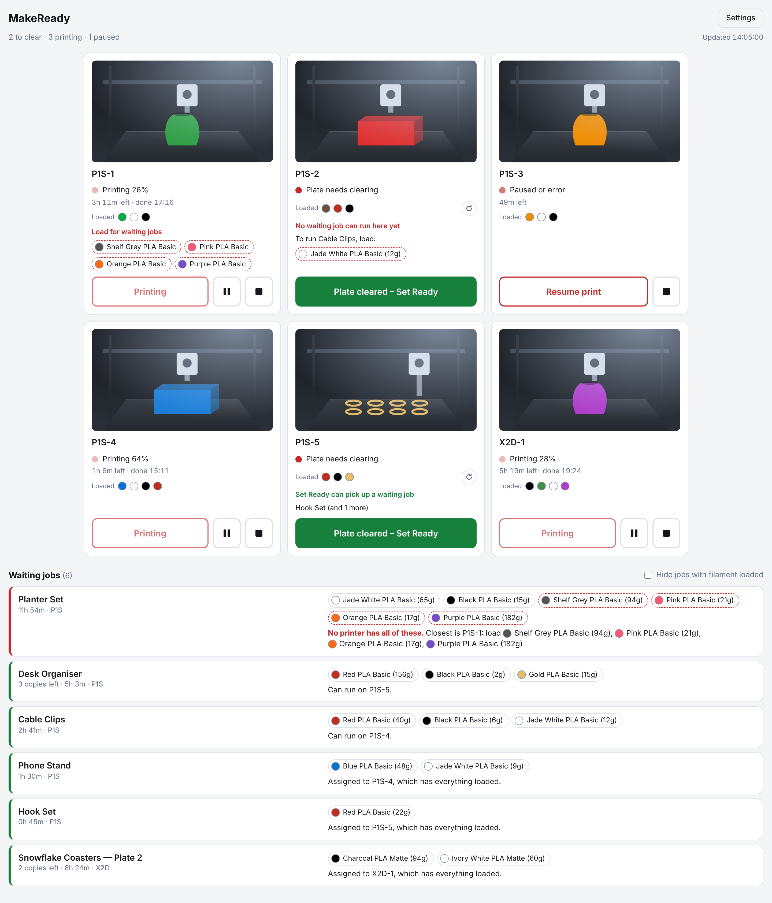

# Watchtower-SetReady

A control page for a [Watchtower](https://watchtower3d.com) 3D-printer farm. It started
as virtual **Set Ready** buttons, doing the job of the
[ClearCue](https://github.com/ThePrintBench/ClearCue) hardware buttons without buying or
building any, and now shows the whole farm on one screen. Open it on a phone, a tablet
or a wall-mounted display.

For each printer it shows:

- its state, progress, time left and finish time;
- a **Set Ready** button when the plate is waiting to be cleared;
- **pause**, **stop** and **resume** buttons, each with a confirmation;
- a camera snapshot (optional);
- the filament loaded in its slots (optional).

Under the printers, a **Waiting jobs** list (optional) shows what each queued job needs
and which printer could run it, or what would have to be loaded where.



*Mock-up with sample data.*

It is one small Python server and one HTML page, with no dependencies. Not affiliated
with or endorsed by Watchtower.

## Contents

- [Quick start](#quick-start)
- [Settings](#settings)
- [Using the page](#using-the-page)
- [Docker and Unraid](#docker-and-unraid)
- [Security](#security)
- [How it works](#how-it-works)
- [Limitations](#limitations)
- [Licence](#licence)

## Quick start

Needs Python 3.8 or later and nothing else. For Docker or Unraid, see
[below](#docker-and-unraid).

1. In Watchtower, create an API key (starts with `wt_`) with the `control` scope,
   allowed to send `set_ready` and, for the other buttons, `resume`, `pause` and `cancel`.
2. Run `python3 server.py` and open `http://localhost:8080`.
3. The **Settings** dialog opens on first use. Enter the Watchtower address and the API
   key, then **Save**.

To use the page from other devices, start it with `HOST=0.0.0.0` and
[set a page password](#page-password).

## Settings

Everything is set from the **Settings** button in the page header and saved to
`config.json` next to `server.py` (or in `/config` in the Docker image). Secrets are
never sent back to the browser once saved.

### Watchtower connection

- **Watchtower address:** the IP address or name of the Watchtower computer, e.g.
  `192.168.1.50`. `https://` and `/api/public/v1` are added for you; type `http://…` or
  a `:port` if yours needs one.
- **API key:** the key from step 1. It has to be re-entered whenever the address
  changes, so a saved key can't be redirected to another machine.
- **Skip the certificate check:** tick this for `https://` unless you have set
  `WATCHTOWER_CA` (see [Other options](#other-options)). Watchtower signs its
  certificate with its own local CA, which Python doesn't trust by default.

### Cameras and queue (optional)

Camera pictures, the waiting-jobs list and loaded filament aren't part of Watchtower's
public API, so the API key can't fetch them. Enter a **Watchtower username and
password** and the server logs in to Watchtower's own web interface for them. Leave the
username blank to do without.

Two consequences of using that login:

- The password is stored in `config.json`, and it grants much more than the API key
  does. Use a dedicated Watchtower user with as few rights as possible if you can.
- That interface is undocumented and can change with a Watchtower update. If it does,
  pictures and the queue stop; the buttons keep working.

### Page password

Without a password, **anyone who can open the page can press the buttons, stop prints
and change the settings.** To lock it, enter a **Page password** of at least 8
characters. From then on every device has to log in once before it can see or do
anything; it stays logged in for a year, across restarts and updates.

- Changing the password logs out every other device.
- **Remove the password** opens the page up again; **Log out** logs out just this device.
- Five wrong passwords from one address block further tries from it for a minute.
- The password is stored as a salted hash, never in plain text.
- Forgotten it? Set `PAGE_PASSWORD_HASH` to `""` in `config.json` and restart.

### Other options

These go in `config.json` (see `config.example.json`) or in environment variables of the
same name. Environment variables win.

| Option | Purpose |
|---|---|
| `HOST` | `127.0.0.1` (default) serves the page only on this computer; `0.0.0.0` makes it reachable from the network |
| `PORT` | Port to listen on, default `8080` |
| `WATCHTOWER_CA` | Path to Watchtower's CA certificate (PEM), to verify `https://` properly instead of skipping the check |
| `PAGE_PASSWORD` | The page password, in plain text; takes precedence over one set in Settings |
| `CONFIG_DIR` | Folder holding `config.json` (environment only) |
| `WATCHTOWER_URL`, `WATCHTOWER_API_KEY`, `WATCHTOWER_USERNAME`, `WATCHTOWER_PASSWORD` | The same values as the Settings dialog |

## Using the page

### Printer cards

| Card | Meaning | Buttons |
|---|---|---|
| Green | Ready for the next job | Nothing to do |
| Red dot, solid green button | Plate waiting to be cleared | **Plate cleared – Set Ready**: press once the plate is clear |
| Red, slow pulse | Printing, with progress, time left and finish time | Small **pause** and **stop** buttons |
| Red, fast blink | Paused or error, with time left | **Resume print** and a small **stop** button |
| Amber | Watchtower reports the printer offline | None |

Confirmations, so a stray touch on a wall tablet can't move a machine or lose a print:

- **Pause** and **Stop** open a dialog first. Stop cancels the job; it can't be resumed.
- **Resume** needs a second tap within 4 seconds.
- **Set Ready** is a single tap.

If Watchtower refuses a command, the reason appears under the button.

The page refreshes every 5 seconds. The browser tab title shows how many plates are
waiting, e.g. `(2) Watchtower SetReady`.

### Cameras

With the Watchtower login set, each card shows a snapshot that refreshes every 5 seconds
(a still image, not live video). A camera named "chamber" is preferred when a printer
has several; printers with no online camera show no picture.

### Loaded filament and waiting jobs

With the Watchtower login set:

- **On each card:** a row of colour swatches for the filament loaded in its slots. Hover
  or tap a swatch for the name, type, grams left and slot. While the printer isn't
  printing, a small refresh button beside the swatches re-reads what Watchtower reports
  as loaded straight away, for when you have just swapped a spool. Below it, advice
  about the queue:
  - *Idle printer* (plate waiting, or ready): either **Set Ready can pick up a waiting
    job**, naming the oldest job its loaded filament can run, or **No waiting job can
    run here yet**, with the job that is the closest match (fewest filaments to load;
    the oldest job wins a tie) and exactly what to load for it.
    If the job needs more of a filament than is left on the loaded spool, the card says
    **Not enough filament loaded**, and pressing Set Ready asks first; you can carry on
    anyway.
  - *Busy printer:* a red **Load for waiting jobs** list, only when a job can't run
    anywhere and this printer is the closest fit.
- **Under the cards:** the **Waiting jobs** list. Each job shows the filaments it needs
  and the weight of each, e.g. "Gold PLA Basic (15g)", with missing ones outlined in
  red, and a verdict:
  - which printers can run it now;
  - its assigned printer has everything, or is missing something;
  - no printer has everything, with the closest printer and what to load into it.

Jobs with everything loaded have a green edge, the others a red one. **Hide jobs with
filament loaded** leaves only the ones that need attention; the choice is remembered per
device.

Colours are shown as swatches, with the spool's colour name when that exact spool is
loaded somewhere on the farm.

The matching is this page's own estimate, not Watchtower's scheduler:

- material must match, and variant (Basic, Matte) when both are known;
- colour must be the same for jobs in "exact" mode, and close for jobs in "closest" mode;
- only printers of the job's model are considered;
- empty slots count as nothing loaded;
- grams left is an estimate: the printer's reported percentage of the spool's full
  weight. It is used for the low-filament warning, not for matching.

Watchtower makes the final decision, so treat "load X into Y" as a guide.

### Layout

The cards arrange themselves from the screen size and the number of printers:

- rows are evened out, so no printer sits alone on a row;
- when every printer fits without scrolling, the cards grow to fill the screen, which
  suits a wall display;
- on smaller screens the cards keep a readable size and the page scrolls;
- phones get one column.

Light and dark themes follow the device setting.

## Docker and Unraid

The image listens on port 8080 and keeps `config.json` in `/config`.

```bash
docker run -d --name watchtower-setready --restart unless-stopped \
  -p 8090:8080 -v /path/to/settings:/config \
  ghcr.io/m4-consulting-ltd/watchtower-setready:latest
```

The image is built and pushed to GitHub's container registry by
`.github/workflows/docker.yml` on every change to `main`. To build it yourself instead,
run `docker build -t watchtower-setready .` in this folder.

### Unraid

1. Copy `unraid/watchtower-setready.xml` to the flash drive as
   `/boot/config/plugins/dockerMan/templates-user/my-watchtower-setready.xml`
   (over the network that is the `flash` share, folder
   `config/plugins/dockerMan/templates-user`).
2. In Unraid: **Docker → Add Container → Template → watchtower-setready**, check the
   port (default 8090) and settings folder (default
   `/mnt/user/appdata/watchtower-setready`), then **Apply**.
3. Open the container's **WebUI**, fill in Settings and set a page password.

On a custom network such as `br0` the container has its own IP address and Unraid
ignores the port mapping: the page is at `http://<container-ip>:8080`. To use another
port there, add a `PORT` variable to the container.

To update: **Docker → Check for Updates**, then update the container. If it reports
"up-to-date" straight after a new build, edit the container and **Apply** without
changes to force a fresh pull. Settings are kept, since they live in the settings folder.

## Security

- **Set a page password** before making the page reachable from the network. Without
  one the page is open to anyone who can reach it.
- **Plain HTTP:** the page password and session travel unencrypted on your network. That
  is fine on a trusted home or workshop network. Do not expose the page to the internet;
  for outside access use a VPN or a reverse proxy that adds HTTPS.
- **Secrets stay on the server:** the API key and Watchtower password are held in
  `config.json` (written readable only by its owner) and never sent to the browser.
- **Limited commands:** the server forwards only `set_ready`, `resume`, `pause` and
  `cancel`, and only to the Watchtower address in Settings.
- **Other websites can't drive it:** cross-origin requests are refused and the page
  can't be embedded in a frame.

## How it works

`server.py` serves `index.html` and forwards a fixed list of calls to Watchtower. The
page talks to this small server rather than straight to Watchtower so the API key never
reaches the browser, and so the browser doesn't have to trust Watchtower's certificate
or be allowed by its cross-origin rules.

Public API, using the API key:

| Page calls | Watchtower call |
|---|---|
| `GET /api/printers` | `GET {base}/printers` |
| `POST /api/printers/{name}/set-ready` | `POST {base}/printers/{name}/commands` with `{"command":"set_ready"}` |
| `POST /api/printers/{name}/resume` | the same call with `{"command":"resume"}` |
| `POST /api/printers/{name}/pause` | the same call with `{"command":"pause"}` |
| `POST /api/printers/{name}/stop` | the same call with `{"command":"cancel","confirm":true}` |

Private web API, using the Watchtower login:

| Page calls | Watchtower call |
|---|---|
| `GET /api/cameras`, `GET /api/camera/{name}` | `GET /api/system/streams`, `GET /api/go2rtc/frame.jpeg?src=…` |
| `GET /api/queue` | `GET /api/queue`, `GET /api/filament/assignments`, `GET /api/printers` |

The server's own calls: `GET`/`POST /api/config` (settings), `GET /api/session`,
`POST /api/login` and `POST /api/logout` (page password).

The state rules come from ClearCue: offline when `online` is false; printing when
`busy` (paused or error if a status string says so); ready when `ready`; otherwise the
plate is waiting and the Set Ready button is live.

## Limitations

- **Unofficial API use:** Watchtower's API documentation wasn't available when this was
  written. The printer list, the `pause`, `resume` and `cancel` commands and everything
  on the private web API were worked out from ClearCue, a third-party client and real
  responses from one Watchtower install. Another Watchtower version may differ.
- **Paused or error:** the page can't tell the two apart, so **Resume print** also shows
  on a printer in an error state, where Watchtower is expected to reject it.
- **Filament matching is an estimate**, as described
  [above](#loaded-filament-and-waiting-jobs).
- **Snapshots, not video.**

## Licence

Copyright (C) 2026 M4 Consulting Ltd.

This program is free software: you can redistribute it and/or modify it under the terms
of the GNU General Public License, version 3, as published by the Free Software
Foundation. It is distributed in the hope that it will be useful, but WITHOUT ANY
WARRANTY; without even the implied warranty of MERCHANTABILITY or FITNESS FOR A
PARTICULAR PURPOSE. See [LICENSE](LICENSE) for the full text.

The printer-state rules and the `set_ready` call are derived from
[ClearCue](https://github.com/ThePrintBench/ClearCue), which is distributed under the
GPLv3; this project uses the same licence.
