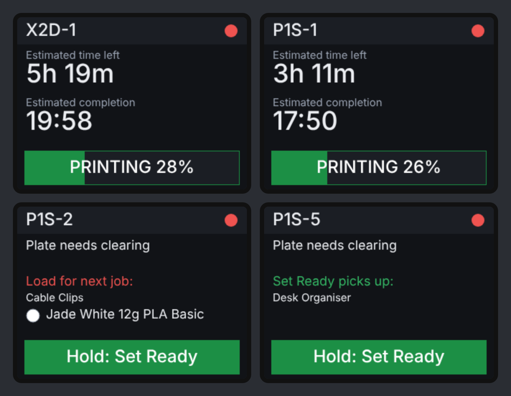

# Printer display

A small touch screen for the front of one printer. It shows the printer's state, what
filament to load for the next waiting job, and a **Set Ready** button.

*Mock-up of the layout with sample data.*

**Status:** running on a real two-socket board (ST7789 screen): flashing, both setup
steps and the printer screen work. The touch button has not been tried yet.

## What you need

- An **ESP32-2432S028** board ("Cheap Yellow Display"): 2.8" 320×240 screen, single
  micro-USB port. The `R` version has resistive touch; without touch it still works as a
  display, but the Set Ready button can't be pressed.
- A micro-USB **data** cable and a computer with Chrome or Edge, for the one-off flash.
- A phone, for the setup steps.
- The SetReady server reachable from your Wi-Fi (2.4 GHz), with the Watchtower login set
  in Settings if you want the filament advice.

Every board runs the same firmware. Nothing is edited per printer; each board is told
its Wi-Fi, server and token after it starts.

## 1. Flash the board (once)

1. Download the firmware from the
   [display-latest release](https://github.com/M4-Consulting-Ltd/Watchtower-SetReady/releases/tag/display-latest).
   These boards ship with one of three screens that look identical, so there are three
   files. Start with the first; if the picture is scrambled, flash the next one.

   | File | Screen | Usually found on |
   |---|---|---|
   | `printer-display.factory.bin` | ILI9341 | boards with a single micro-USB port |
   | `printer-display-st7789.factory.bin` | ST7789 | boards with micro-USB and USB-C (confirmed on one) |
   | `printer-display-ili9342.factory.bin` | ILI9342 | some boards with micro-USB and USB-C |

2. Plug the board into the computer and open <https://web.esphome.io> in Chrome or Edge.
3. Click **Connect**, pick the board's serial port, then **Install** and choose the file.

This **replaces whatever firmware is on the board**. If the port doesn't appear, hold the
board's **BOOT** button while plugging it in.

## 2. Set it up (on the board)

The screen walks you through two steps, each with a QR code to scan with your phone's
camera, so there is nothing to type to get to the right page.

**Step 1 of 2: Wi-Fi.** Scan the code on the screen. Your phone offers to join the
board's own network (its name, such as `printer-display-a1b2c3`, is shown at the
bottom). Once joined, a page opens by itself; if it doesn't, browse to
`http://192.168.4.1`. Choose your own Wi-Fi and enter its password.

**Step 2 of 2: server and token.** The board joins your Wi-Fi and shows a second code.
Put your phone back on your normal Wi-Fi and scan it to open the board's settings page
(its address is also shown at the bottom). Fill in:

- **SetReady page address:** where the SetReady page runs (what is in your browser's
  address bar when you open it), e.g. `192.168.2.2:8080`. Not Watchtower's address.
  `http://` is added for you.
- **Display token:** on the SetReady page, open **Settings → Printer displays**, choose
  the printer this board is for, press **Create token**, and paste it here.

Then press **Apply and restart**. The board restarts and shows the printer within a few
seconds. The settings are kept on the board and survive power cuts.

**Changing things later.** Open the board's address again to change the server or
token. Whenever the server can't be reached, the screen shows the reason with a QR code
to that page.

**Moving to another Wi-Fi.** On the board's page, fill in **Wi-Fi change 1: new network
name** and **Wi-Fi change 2: new network password**, then press **Wi-Fi change 3:
connect to new network**. The board tries the new network for 30 seconds. If it joins,
it stays there and remembers it, and its address will probably change (the screen shows
the new one if needed). If it can't join, it stays on the network it had; the page's
**Wi-Fi change: result** line says which happened. If the old network is already gone,
the board returns to step 1 after about a minute instead.

**Starting up.** After power-on the screen shows a start-up page ("Connecting to
Wi-Fi…", then "Contacting server…") until the printer appears. The setup QR codes are
only shown if the board actually needs setting up.

## Building it yourself (optional)

With [ESPHome](https://esphome.io/guides/installing_esphome) installed:
`esphome run printer-display.yaml`. The `default_server` and `default_token` values at
the top of the file can bake those two settings in, which saves step 2 when you are
only making one.

## What the screen shows

- **Top bar:** the printer's name and a dot: green when ready, red when printing, paused
  or waiting to be cleared, amber when offline.
- **While printing:** the estimated time left and the estimated completion time in
  large type, and a bar along the bottom reading "PRINTING 28%" that fills with green
  as the print goes on. Nothing about waiting jobs is shown while the printer is busy.
- **Otherwise, a status line:** e.g. "Plate needs clearing" or "Paused or error".
- **Advice, once the print is finished:**
  - "Load for next job:" with the job and the filament to load, each with a colour dot.
  - "Set Ready picks up:" with the job, when the loaded filament already covers one.
  - An amber "Low:" line when the spool has less than the job needs.
- **Hold: Set Ready:** appears when the plate is waiting to be cleared. Hold it for a
  second; it turns brighter while held, then sends. A brush against the screen does nothing.

It asks the server every 10 seconds.

## If something is wrong

| What you see | Likely cause |
|---|---|
| Stuck on "Setup: step 1 of 2" | Wrong Wi-Fi password, or a 5 GHz-only network; join the board's network again and re-enter |
| "Can't reach server" | Wrong server address or port (it is shown underneath), or the server isn't reachable from Wi-Fi |
| "Not a SetReady server" | The address is something else, most often Watchtower itself; enter the SetReady page's address and port |
| "Token not accepted" | Token mistyped, or revoked in Settings; create a new one and enter it on the board's page |
| "Not found in Watchtower" | The printer was renamed; create a new token |
| Scrambled picture, or inverted colours | The firmware is for a different screen type; see below |
| Touches land in the wrong place | Touch calibration; see below |

**Scrambled picture or wrong colours.** The firmware doesn't match the board's screen
type. Flash one of the other two files listed under "Flash the board". Flashing again
keeps the Wi-Fi, server and token already entered.

**Upside down.** The published files are built with `rotation: "270"`. For the other
way up, build it yourself with `rotation: "90"` and both `touch_mirror_x` and
`touch_mirror_y` set to `"false"` at the top of `printer-display.yaml`.

**Touch calibration.** Wherever you touch the screen, a small white ring appears for a
moment at the spot the board thinks you touched. If the ring is somewhere else, the touch
settings need adjusting: flip `touch_mirror_x` or `touch_mirror_y` at the top of
`printer-display.yaml` if it is mirrored. For fine tuning, the board's own page shows a
log line for each touch with the raw values; adjust the `calibration` numbers to match
the corners.

## Who can change a board's settings

The board's settings page has no login, like the board itself: anyone on your Wi-Fi who
opens its address can change the server or token. The token is never shown back.

## What a display is allowed to do

A token works for one printer only. With it, a display can read that printer's summary
and send Set Ready for it. It can't see other printers, cameras or settings, and can't
pause or stop a print. Revoke a token under **Settings → Printer displays** if a screen
is lost or replaced.
