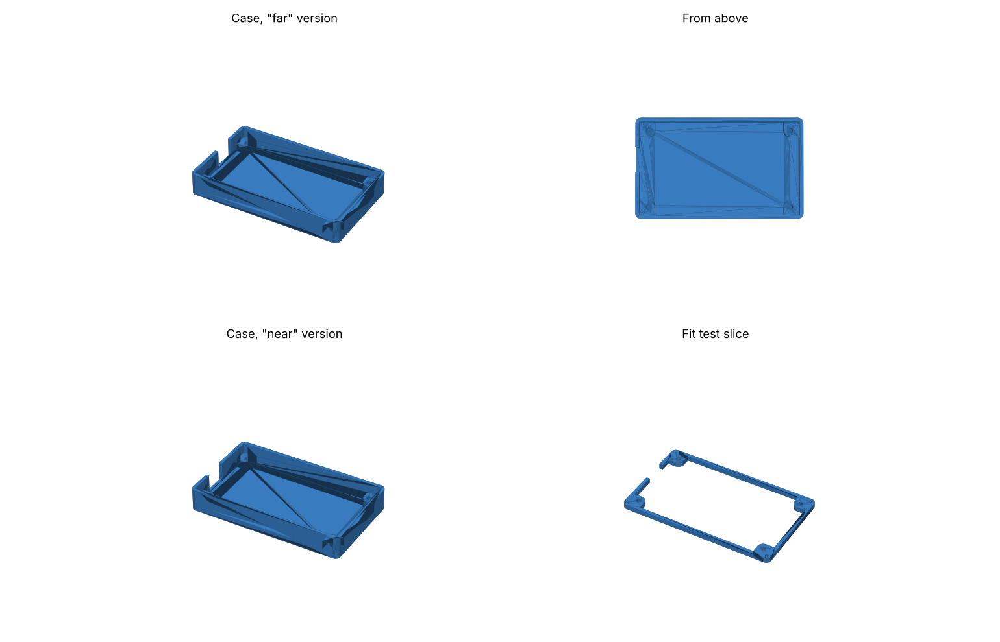

# Case for the 2.8inch ESP32-32E display board

A printable back shell for the orange LCDWiki **2.8inch ESP32-32E** board (E32R28T):
the board drops in screen-up and four screws through its own mounting holes hold it. The
back is flat, for 3M tape. The only opening is a slot for the USB-C plug.

Not yet printed or fitted to a board: print the fit test first.

## Which file

Hold the board screen-up with the USB socket on your left. The socket is off-centre:

- nearer the edge **away from you**: print the `usb-far` files;
- nearer the edge **towards you**: print the `usb-near` files.

| File | What it is |
|---|---|
| `esp32-32e-fit-test-usb-*.stl` | A 3 mm slice of the case. Prints in a few minutes; lay the board on it to check the outline, the four holes and the USB slot before printing the case. |
| `esp32-32e-case-usb-*.stl` | The case: 90.6 × 54.6 × 13.1 mm, about 17 cm³ of plastic. |

## Printing and fitting

- Print flat on its back, no supports. 0.2 mm layers, any rigid filament (PETG or ABS/ASA
  if it sits on a warm printer; PLA softens there).
- Fix the board with four **M3 × 6 mm** screws. They cut their own thread in the posts;
  don't overtighten.
- Stick 3M tape to the flat back.

## Changing it

`make-case.py` holds the board's measurements at the top and writes the STL files
(`pip install manifold3d trimesh`, then `python3 make-case.py`). The measurements used:
board 86 × 50 mm, 5.5 mm from the glass to the back of the PCB, 4.6 mm tallest part on
the back, 3.2 mm holes at 77.1 × 41.6 mm centres, USB-C centre 20.3 mm from the nearer
long edge.
